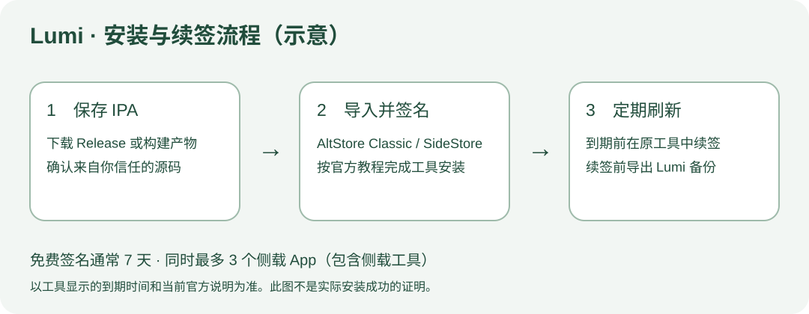

# Lumi 安装与续签

发布文件为未签名 iPhoneOS IPA，最低需要 iOS 17。需要先由自己的安装工具签名，才能在设备上运行。



## 下载与校验

在 [最新 Release](https://github.com/NakanoNino233/Lumi/releases/latest) 下载 `Lumi-unsigned.ipa` 和 `Lumi-unsigned.ipa.sha256`，放在同一目录。在 Mac 终端中进入该目录，运行：

```bash
shasum -a 256 -c Lumi-unsigned.ipa.sha256
```

显示 `OK` 表示文件与发布的校验值一致。

## 签名与安装

使用自己选择的签名安装工具，例如 AltStore Classic 或 SideStore。按工具的官方指南完成工具本身的安装与设备准备，再选择下载的 `Lumi-unsigned.ipa` 进行签名安装。

- [AltStore Classic 官方指南](https://faq.altstore.io/altstore-classic/your-altstore)
- [SideStore 官方指南](https://docs.sidestore.io/)

Lumi 包含 `LumiWidgets` 扩展。需要小组件与实时活动时保留该扩展；实际签名能力和设备名额以所用账号与工具显示为准。

打开 App 后填写个人资料卡。需要 AI 回复时，在「我的 → 设置 → API 配置」中填写自己的服务商与 API Key。

## 更新与续签

在原签名工具中检查安装有效期并按其要求刷新。免费开发签名的有效期通常较短，请以设备实际描述文件为准。Lumi 的「安装与续签」页面可读取描述文件到期时间；无法读取时提供手动日期估算。

更新前在 Lumi 内导出备份，并尽量使用原工具更新同一应用。删除 App 会移除本机应用数据，请先备份。

## 自行构建

在源码根目录运行：

```bash
bash Distribution/build-unsigned.sh
```

结果在 `Distribution/output/`，包含 IPA、校验文件和压缩包检查结果。模拟器可以直接从 Xcode 运行；真机从 Xcode 安装时，需要为主程序及小组件选择自己的开发团队与 Bundle Identifier。

GitHub Actions 支持手动构建；推送 `v` 开头的标签时构建并发布 Release。工作流需要可用的 Xcode 26 和相应 iPhoneOS SDK，构建状态请以 Actions 的实际结果为准。
