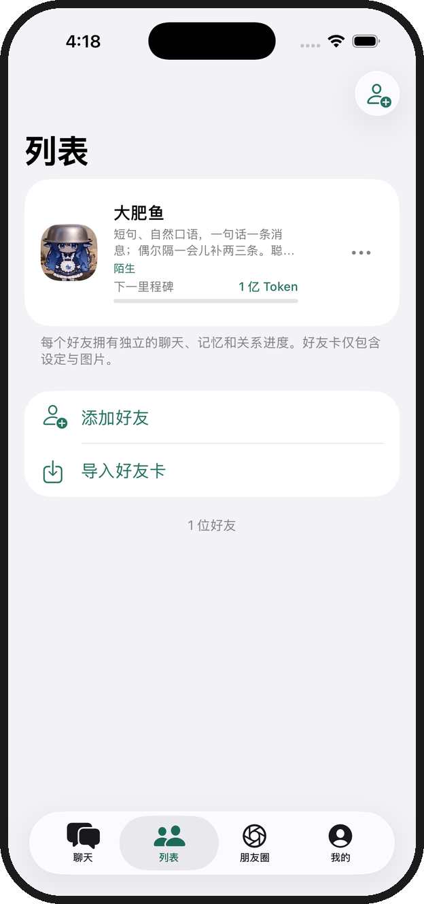
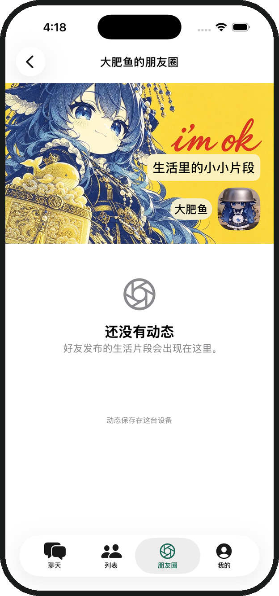
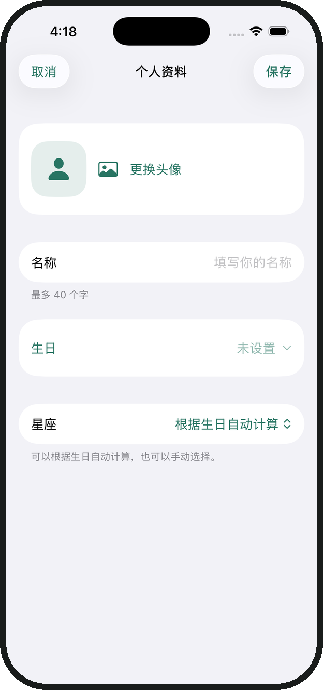

<p align="center"><a href="README.md">简体中文</a> · <strong>English</strong></p>

<p align="center">
  
</p>
<h1 align="center">Lumi</h1>
<p align="center"><strong>Everyday conversations with AI friends. A place for the stories you share.</strong></p>
<p align="center">Native iOS chat · Custom characters · Local memories · Moments</p>
<p align="center">
  
  
  
</p>
<p align="center">
  <a href="https://github.com/NakanoNino233/Lumi/releases/latest">Download IPA</a> ·
  <a href="#getting-started">Getting started</a> ·
  <a href="#features">Features</a> ·
  <a href="#build-from-source">Build from source</a>
</p>

---

Lumi brings conversations, character profiles, memories, and everyday updates together in one app. Start with the built-in friend **大肥鱼 (Da Fei Yu)**, or create your own AI friends, each with their own personality, conversations, and shared history.

**Bring your own model API key. The downloadable IPA is unsigned and must be signed before installation. The current source is available under a noncommercial license; commercial use requires separate permission.**

## A look at Lumi

<table>
  <tr>
    <th width="33%">Your friends</th>
    <th width="33%">Everyday moments</th>
    <th width="33%">Getting to know you</th>
  </tr>
  <tr>
    <td align="center"></td>
    <td align="center"></td>
    <td align="center"></td>
  </tr>
</table>

Actual app screenshots using a blank demo profile, shown in Chinese. Lumi supports Chinese and English. You can customize friend avatars, covers, and your own profile.

## Features

| What you want to do | What Lumi offers |
| --- | --- |
| Chat about your day | Streaming replies, image attachments, voice input, read-aloud, stickers, group chats, and conversation sharing |
| Create your own characters | Edit avatars, personalities, backstories, speaking styles, and opening messages; import or export JSON character cards |
| Keep shared memories | Local memories, diaries, anniversaries, relationship progress, and optional proactive greetings |
| Share everyday moments | Posts, comments, likes, custom covers, and personal tags in Moments |
| Let friends get to know you | An editable avatar, name, birthday, and zodiac sign; your Moments avatar follows your profile |
| Choose your model provider | DeepSeek, ChatGPT, Claude, and custom configuration templates with editable endpoints, model names, and capability switches |
| Make the app your own | Token usage statistics, themes, dark mode, Chinese and English, widgets, Live Activities, and backup and restore |

Image understanding and other model capabilities depend on the model you configure. Automatic memories, diaries, and connection tests may also make API calls and incur provider charges.

## Getting started

### 1. Download and install

Get `Lumi-unsigned.ipa` from [Releases](https://github.com/NakanoNino233/Lumi/releases/latest). A SHA-256 checksum file is available alongside it. **iOS 17 or later is required.**

Sign the IPA with your preferred installation tool before installing it on your iPhone. Follow the official instructions for your tool, such as [AltStore Classic](https://faq.altstore.io/altstore-classic/your-altstore) or [SideStore](https://docs.sidestore.io/). Keep the bundled `LumiWidgets` extension if you want widgets and Live Activities.

To verify the download on a Mac, place the IPA and checksum file in the same folder and run:

```bash
shasum -a 256 -c Lumi-unsigned.ipa.sha256
```

An `OK` result means the file matches the published checksum. See the [detailed installation and renewal guide (Chinese)](Documentation/Installation.md) for more information.

### 2. Set up your profile

On first launch, add your avatar, name, birthday, and zodiac sign. You can edit them later in **Me**. Your Moments avatar updates with your profile, and friends refer to your profile when you ask about your birthday.

### 3. Connect a model

Open **Me → Settings → API settings**, select a template, and enter the endpoint, model name, and your own API key. Test the connection, then save.

| Template | What you need |
| --- | --- |
| DeepSeek | Your provider's API key and an available model name |
| ChatGPT | An OpenAI API key and a model available to your account |
| Claude | An Anthropic API key and a model available to your account |
| Custom | A compatible service endpoint, API key, and model name |

Templates help fill in settings; they do not include API credits. **Use a model name that is actually available in your provider account**, and match the image and tool capability switches to that model. Check with your provider about chat subscriptions and separate API billing.

### 4. Start a conversation

Open Da Fei Yu in **Chats**, or add a friend in **Friends**. Adjust their personality, have a conversation, and set a cover and tags in **Moments**. Export an in-app backup before updating or moving to another device.

## Data and privacy

Conversations, profiles, memories, and preferences are stored on your device. API keys are stored in the system Keychain. Model requests send the relevant content to your configured provider; automatic memories and diaries also use relevant conversation history. Optional features such as weather require separate activation or permission.

Backups contain your profile and conversations, **but not API keys**. Keep backups private, and remove personal information before sharing screenshots or reporting issues.

## Common questions

<details>
<summary>Why can't I install the IPA directly?</summary>

The release IPA is unsigned. It must be signed before it can run on an iPhone. Follow your installation tool's official setup and renewal instructions.

</details>

<details>
<summary>Why am I not getting a reply?</summary>

Run the connection test in API settings. Check the endpoint, API key, account balance, and model name. Template model names are editable and must match the models your account can access. Hide your API key and private conversations when reporting a problem.

</details>

<details>
<summary>How do I keep my chats when updating or changing phones?</summary>

Export a backup first, and use the same signing tool to update the existing app where possible. Deleting the app removes its local data. On a new device, import your backup and enter your API key again.

</details>

<details>
<summary>Can I use Lumi in a commercial product?</summary>

The current license does not authorize commercial use. Personal study, research, and noncommercial use must follow [LICENSE](LICENSE). Paid distribution and commercial product integration require separate permission. Earlier releases and third-party assets have separate licensing considerations, explained below.

</details>

## Build from source

Open `Lumi.xcodeproj` in **Xcode 26 or later**, select the `Lumi` scheme and an iPhone simulator, then run. The app uses Swift 6, SwiftUI, and SwiftData. ZIPFoundation is included as a local dependency.

For a physical device, select your own development team in Signing & Capabilities for both the app and `LumiWidgets`, and change both Bundle Identifiers as needed.

<details>
<summary>Build an IPA and run tests</summary>

From the repository root:

```bash
bash Distribution/build-unsigned.sh
```

The unsigned IPA is written to `Distribution/output/`. Installers are distributed through GitHub Releases; build caches, local test reports, user settings, and signing files are excluded from the source repository.

Use Product → Test in Xcode. Automated tests use local mock responses and do not require a real model API key. The “Build Lumi unsigned IPA” Actions workflow supports manual runs; pushing a tag beginning with `v` builds and publishes its release. The initial `1.0.0` release uses a locally validated build.

Model responses, voice and haptics on physical devices, widget presentation, installation, and signing renewal still need verification with real devices and providers.

</details>

## License and contributions

**The current Lumi-owned code is available under the [PolyForm Noncommercial License 1.0.0](LICENSE). Commercial use requires separate permission.** The license text governs permitted uses and all other conditions. This is a source-available project, not software under an OSI-approved open-source license.

The historical `1.0.0` release was published under MIT, and those previously granted rights remain valid. The current license does not revoke them or change third-party licenses. See the [licensing history (Chinese)](LICENSING.md) and the [original MIT license](LICENSES/Lumi-1.0.0-MIT.txt).

Third-party dependencies retain their own licenses. The code license does not grant rights to the app icon, character avatars, Moments covers, or images shown in screenshots. Obtain permission or replace those assets before reusing them. Sources and notices are listed in [third-party and asset notices (Chinese)](THIRD_PARTY_NOTICES.md).

Bug reports and pull requests are welcome. Please include your iOS version, steps to reproduce, and screenshots with private information removed when opening an [issue](https://github.com/NakanoNino233/Lumi/issues).
