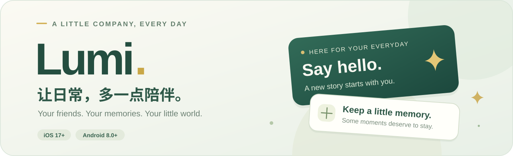
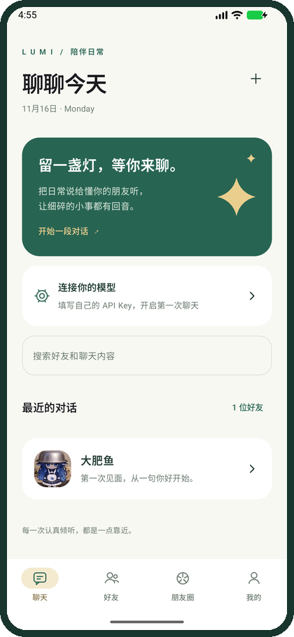
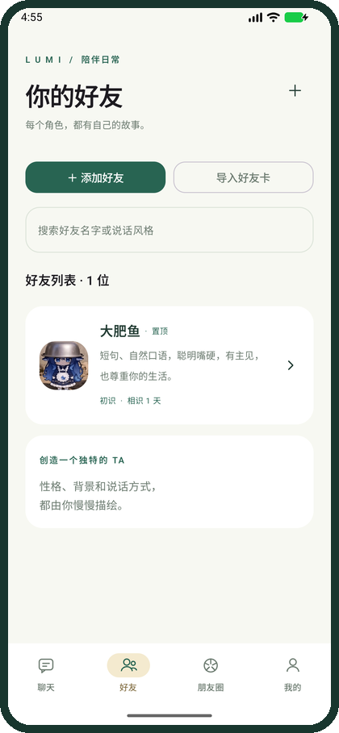
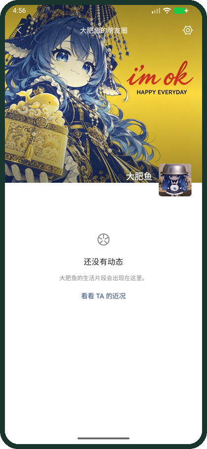
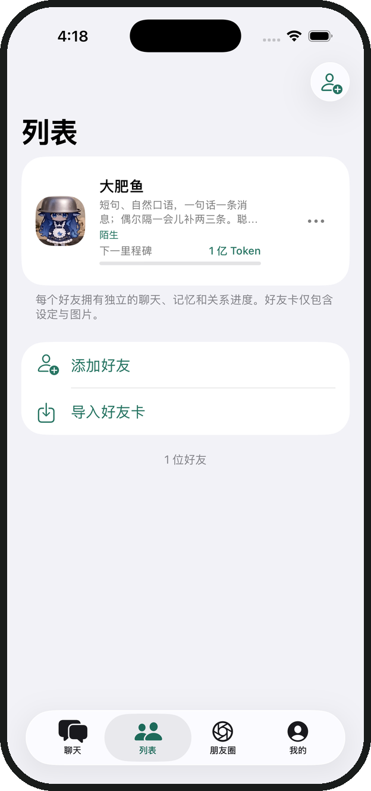
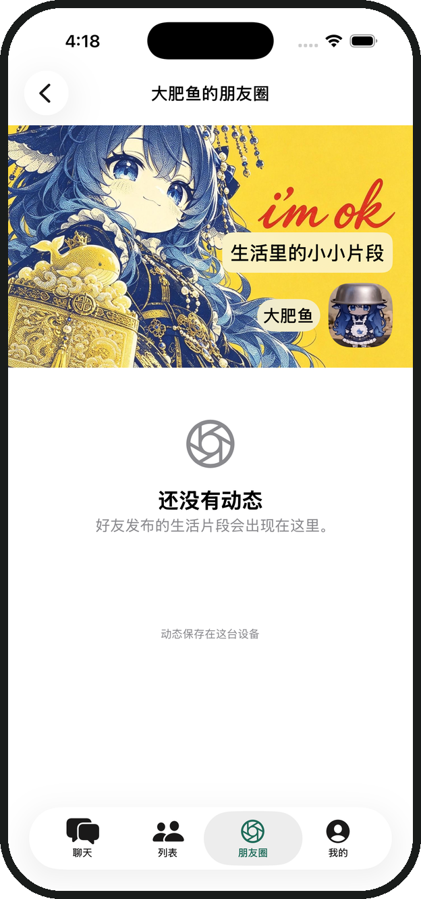
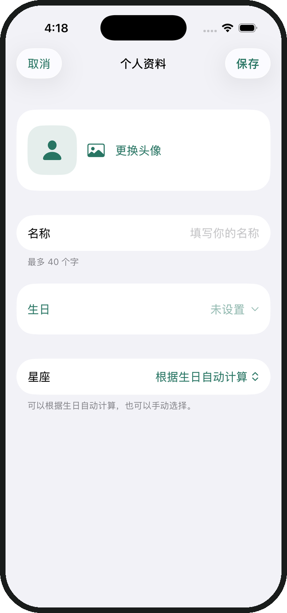

<p align="center"><a href="README.md">简体中文</a> · <strong>English</strong></p>

<p align="center">
  
</p>

<p align="center"><strong>Everyday conversations with AI friends. A place for the stories you share.</strong></p>
<p align="center">Custom characters · Local memories · Diaries &amp; relationships · Moments</p>

<p align="center">
  <a href="https://github.com/NakanoNino233/Lumi/releases/latest/download/Lumi-Android-1.0.4.apk"></a>
  <a href="https://github.com/NakanoNino233/Lumi/releases/latest/download/Lumi-unsigned.ipa"></a>
</p>
<p align="center">
  <a href="https://github.com/NakanoNino233/Lumi/releases/latest"><strong>All downloads &amp; release notes</strong></a> ·
  <a href="#a-look-at-lumi">Screenshots</a> ·
  <a href="#getting-started">Get started</a> ·
  <a href="#build-from-source">Build from source</a>
</p>
<p align="center">
  
  
  
</p>

---

Lumi is a native iOS and Android app for everyday conversations with AI friends. Start with **大肥鱼 (Da Fei Yu)** or create a character of your own. Chat about your day, keep a little memory, and share the small moments that make a story.

<table>
  <tr>
    <td width="33%"><strong>A character to connect with</strong><br>Shape personalities, backgrounds, and ways of speaking. Give every friend a story.</td>
    <td width="33%"><strong>Memories that stay</strong><br>Turn conversations into memories, diaries, anniversaries, and a growing relationship.</td>
    <td width="33%"><strong>Your own little world</strong><br>Friend-specific Moments, covers, comments, and likes for the everyday things you share.</td>
  </tr>
</table>

## Downloads

**The APK and IPA are on [the same latest release page](https://github.com/NakanoNino233/Lumi/releases/latest). Choose the package for your phone.**

| | Android | iPhone / iPad |
| --- | --- | --- |
| Current version | **1.0.4** | **1.0.0** |
| Requirements | Android 8.0+ | iOS 17+ |
| Package | [`Lumi-Android-1.0.4.apk`](https://github.com/NakanoNino233/Lumi/releases/latest/download/Lumi-Android-1.0.4.apk) | [`Lumi-unsigned.ipa`](https://github.com/NakanoNino233/Lumi/releases/latest/download/Lumi-unsigned.ipa) |
| Installation | Signed; open the APK to install | Unsigned; sign it before installation |
| Guide | [Android features, installation, and build instructions (Chinese)](android/README.md) | [iOS installation and renewal (Chinese)](Documentation/Installation.md) |

SHA-256 checksums are available with the packages. The two platforms keep their own version numbers and source projects, with one shared download page.

> **Bring your own model API key.** No model credits or offline model are included. The current source uses a noncommercial license.

## A look at Lumi

### Android · Native Jetpack Compose

<table>
  <tr><th width="33%">Something to talk about</th><th width="33%">Your friends</th><th width="33%">Everyday moments</th></tr>
  <tr>
    <td align="center"></td>
    <td align="center"></td>
    <td align="center"></td>
  </tr>
</table>

<details>
<summary><strong>Show iOS · Native SwiftUI</strong></summary>

<table>
  <tr><th width="33%">Your friends</th><th width="33%">Little moments</th><th width="33%">Getting to know you</th></tr>
  <tr>
    <td align="center"></td>
    <td align="center"></td>
    <td align="center"></td>
  </tr>
</table>

</details>

Actual app screenshots using demo profiles, shown in Chinese. Profiles, avatars, covers, and character settings are customizable. See [third-party and artwork notices](THIRD_PARTY_NOTICES.md) for image rights.

## Features

| What you want to do | What Lumi offers |
| --- | --- |
| Chat about your day | Streaming replies, image attachments, voice input, read-aloud, group chats, and conversation sharing |
| Create a character | Avatars, personalities, backstories, speaking styles, opening messages, and JSON character card import/export |
| Keep shared memories | Local memories, diaries, anniversaries, relationship progress, and optional automatic memory |
| Share little moments | Posts, comments, likes, friend-specific pages, and custom covers |
| Let friends know you | Editable avatar, nickname, birthday, zodiac sign, and personal profile |
| Choose your model | OpenAI Chat Completions and Anthropic Messages compatibility, with custom endpoints |
| Manage your data | Local storage, themes, dark mode, reported token usage, and manual backup/restore |

**Feature coverage differs between platforms.** iOS also includes widgets, Live Activities, proactive greetings, system tools, and skills. See the [Android guide](android/README.md) for Android coverage and migration limits. Image understanding, voice, and model capabilities depend on your system services and provider.

## Getting started

1. **Choose your package.** On Android, install the APK and allow the browser or file manager to install apps if prompted. On iOS, sign and install the IPA using the [installation guide](Documentation/Installation.md).
2. **Create your profile.** Set an avatar, name, and birthday. Open Da Fei Yu or create your own friend.
3. **Connect a model.** Find API settings under **Me**, enter an endpoint, model name, and API key, then test and save.
4. **Start a conversation.** Adjust a character, keep a memory, write a diary, or choose a Moments cover.

Use model names available to your provider account. Connection tests, automatic memories, diaries, and AI-generated Moments may incur provider charges. Chat subscriptions and API credits depend on the provider.

## Data and privacy

- Conversations, profiles, memories, and preferences stay on your device. Model requests send relevant content to the provider you configure.
- API keys use the system Keychain on iOS and Android Keystore encryption on Android.
- Manual backups exclude API keys. Backups contain conversations and personal data; keep them private and re-enter keys after migration.
- Export a backup before updating. Hide keys and private information when reporting issues.

## Build from source

Separate source projects, shared package downloads:

```text
Lumi/
├── android/                 Android Studio · Kotlin / Jetpack Compose
├── Lumi.xcodeproj           Xcode project
├── Lumi/                    iOS · SwiftUI / SwiftData
├── LumiWidgets/             iOS widgets and Live Activities
├── Distribution/            iOS packaging scripts
└── Documentation/           Installation, artwork, and development guides
```

<details>
<summary><strong>Android · Android Studio / Gradle</strong></summary>

Open `android/` in Android Studio. Requires JDK 25 and Android API 37; minimum runtime API 26.

```bash
cd android
./gradlew :app:assembleDebug
./gradlew :app:testDebugUnitTest :app:lintDebug
```

Use `gradlew.bat` on Windows. See the [Android guide](android/README.md) for signed builds, device tests, and feature differences, and [VALIDATION.md](android/VALIDATION.md) for verified results. Release signing keys are not included.

</details>

<details>
<summary><strong>iOS · Xcode / Swift</strong></summary>

Open `Lumi.xcodeproj` with Xcode 26 or later and run the `Lumi` scheme in a simulator. The app uses Swift 6, SwiftUI, and SwiftData, with ZIPFoundation provided locally.

For a physical device, select your development team in Signing & Capabilities for both the app and `LumiWidgets`, and change Bundle Identifiers as needed.

```bash
bash Distribution/build-unsigned.sh
```

Output goes to `Distribution/output/`. Use Product → Test in Xcode; automated tests use local mock responses and need no live model key. A manual iOS packaging workflow is available in GitHub Actions. Live provider, voice, widget, signing, and renewal behavior still require device testing.

</details>

## FAQ

<details>
<summary>Where are the APK and IPA?</summary>

Both are on [the same latest release page](https://github.com/NakanoNino233/Lumi/releases/latest). Choose `.apk` for Android or `.ipa` for iPhone / iPad, or use the buttons at the top of this page.

</details>

<details>
<summary>Why is the model not replying?</summary>

Test your API connection, endpoint, key, account credits, and model name. Match capability switches to the model. No API credits are included. Hide keys and private chats when reporting problems.

</details>

<details>
<summary>Can I update or move between platforms?</summary>

Export a backup before updating and keep the same signing identity. Android and iOS use different full backup formats; Android can import some iOS v1 text data. See the [migration scope](android/README.md). API keys are not migrated.

</details>

<details>
<summary>Can I use Lumi commercially?</summary>

The current source is noncommercial. Commercial use requires separate permission. See [LICENSING.md](LICENSING.md) for historical versions and third-party material.

</details>

## License and contributions

Lumi's own code uses the [PolyForm Noncommercial License 1.0.0](LICENSE). It is source-available under a noncommercial license, rather than an OSI-approved open-source license. The license text defines the full conditions.

Historical version `1.0.0` was released under MIT, and existing grants remain valid. Dependencies keep their own licenses. Artwork rights are separate from code rights; obtain permission or replace images before reuse. See [licensing](LICENSING.md) and [third-party notices](THIRD_PARTY_NOTICES.md).

Issues and pull requests are welcome. Include your platform, system version, reproduction steps, and screenshots with private information removed in [Issues](https://github.com/NakanoNino233/Lumi/issues).

<p align="center"><sub>A little company for the ordinary days.</sub></p>
