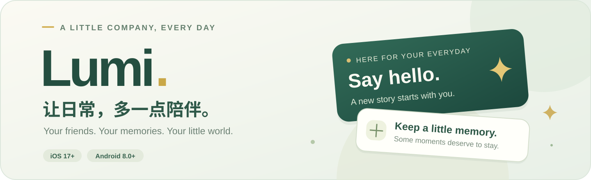
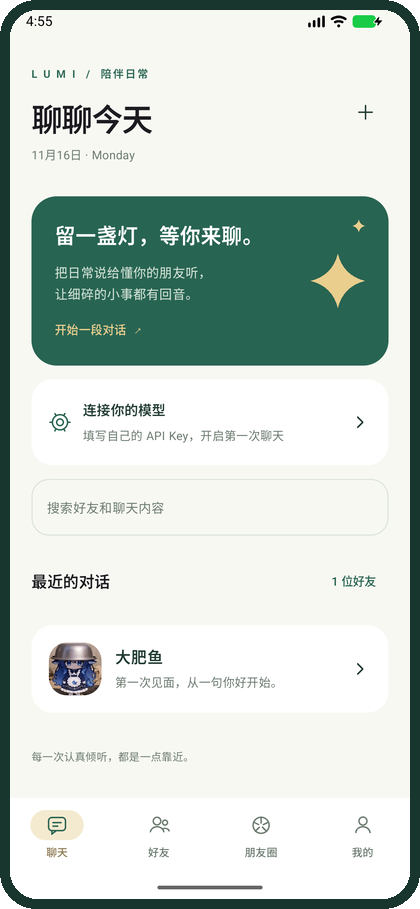
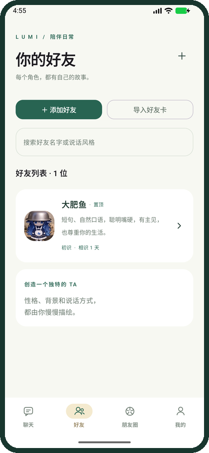
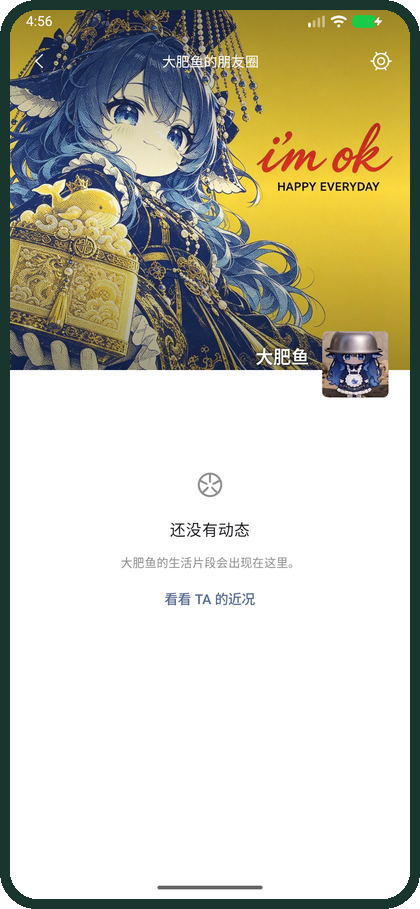
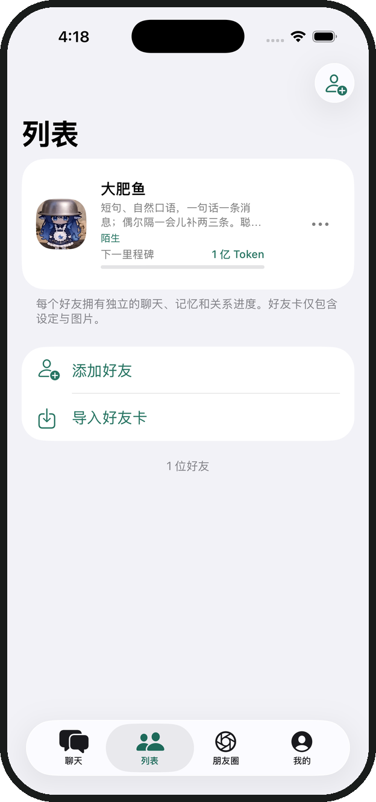
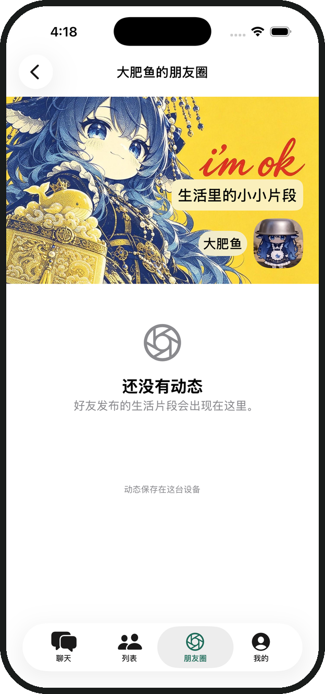
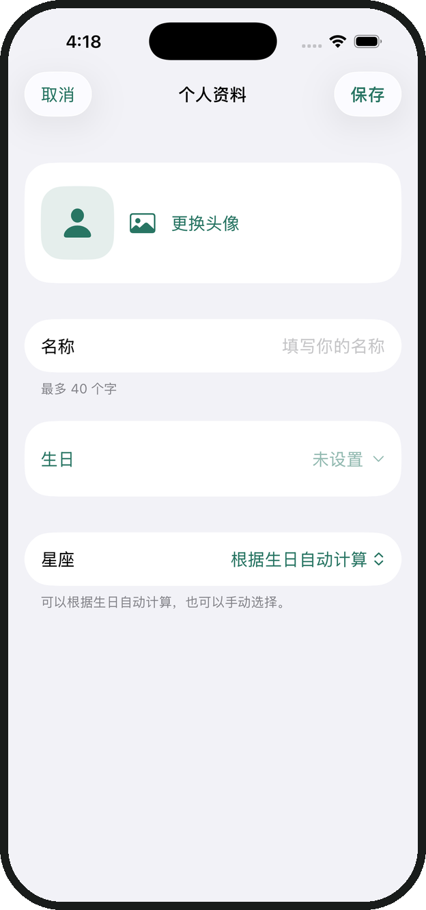

<p align="center"><strong>简体中文</strong> · <a href="README.en.md">English</a></p>

<p align="center">
  
</p>

<p align="center"><strong>和 AI 好友聊日常，也把彼此的故事留在这里。</strong></p>
<p align="center">自定义人设 · 本地记忆 · 日记与关系 · 朋友圈</p>

<p align="center">
  <a href="https://github.com/NakanoNino233/Lumi/releases/latest/download/Lumi-Android-1.0.4.apk"></a>
  <a href="https://github.com/NakanoNino233/Lumi/releases/latest/download/Lumi-unsigned.ipa"></a>
</p>
<p align="center">
  <a href="https://github.com/NakanoNino233/Lumi/releases/latest"><strong>全部安装包与更新说明</strong></a> ·
  <a href="#看看-lumi">界面预览</a> ·
  <a href="#开始使用">开始使用</a> ·
  <a href="#从源码运行">源码构建</a>
</p>
<p align="center">
  
  
  
</p>

---

Lumi 是一款原生 iOS / Android AI 好友应用。从内置好友「大肥鱼」开始，也可以创造自己的角色：聊一段日常，留下一点记忆，再把生活的小片段放进朋友圈。

<table>
  <tr>
    <td width="33%"><strong>聊得来的人设</strong><br>设定性格、背景和说话方式，让每位好友都有自己的故事。</td>
    <td width="33%"><strong>留得住的相处</strong><br>把对话变成记忆、日记与纪念日，慢慢积累彼此的关系。</td>
    <td width="33%"><strong>属于你的生活圈</strong><br>独立的好友动态、封面、评论和点赞，记录日常的小片段。</td>
  </tr>
</table>

## 下载与安装

**APK 和 IPA 都在[同一个最新发布页](https://github.com/NakanoNino233/Lumi/releases/latest)，按自己的手机选择即可。**

| | Android | iPhone / iPad |
| --- | --- | --- |
| 当前版本 | **1.0.4** | **1.0.0** |
| 系统要求 | Android 8.0+ | iOS 17+ |
| 安装包 | [`Lumi-Android-1.0.4.apk`](https://github.com/NakanoNino233/Lumi/releases/latest/download/Lumi-Android-1.0.4.apk) | [`Lumi-unsigned.ipa`](https://github.com/NakanoNino233/Lumi/releases/latest/download/Lumi-unsigned.ipa) |
| 安装方式 | 已签名，下载后打开安装 | 未签名，需要自行签名安装 |
| 详细说明 | [Android 安装、功能与构建](android/README.md) | [iOS 安装与续签](Documentation/Installation.md) |

安装包旁提供 SHA-256 校验文件。两个平台分别开发、保留各自版本号，下载统一在一处。

> **需要自备模型 API Key。** 应用不附带模型额度或离线大模型。当前源码采用非商业许可。

## 看看 Lumi

### Android · 原生 Jetpack Compose

<table>
  <tr><th width="33%">今天，聊点什么</th><th width="33%">你的好友</th><th width="33%">好友的生活片段</th></tr>
  <tr>
    <td align="center"></td>
    <td align="center"></td>
    <td align="center"></td>
  </tr>
</table>

<details>
<summary><strong>展开查看 iOS · 原生 SwiftUI</strong></summary>

<table>
  <tr><th width="33%">你的好友</th><th width="33%">生活里的小片段</th><th width="33%">从认识你开始</th></tr>
  <tr>
    <td align="center"></td>
    <td align="center"></td>
    <td align="center"></td>
  </tr>
</table>

</details>

实际 App 截图，使用演示资料。自己的资料、头像和封面，以及好友的人设与外观都可以调整。图中素材权利说明见[第三方与素材声明](THIRD_PARTY_NOTICES.md)。

## 功能一览

| 想做什么 | Lumi 可以帮你 |
| --- | --- |
| 和好友聊日常 | 流式回复、图片附件、语音输入、消息朗读、群聊与聊天记录分享 |
| 创造自己的角色 | 头像、人设、背景故事、说话风格、开场白，以及 JSON 好友卡导入与导出 |
| 留下相处的记录 | 本地记忆、日记、纪念日、关系进度与可选的自动记忆 |
| 分享生活片段 | 朋友圈动态、评论与点赞，独立好友页面和自定义封面 |
| 让好友了解你 | 可编辑的头像、昵称、生日、星座和个人资料 |
| 自选模型服务 | 兼容 OpenAI Chat Completions、Anthropic Messages 与自定义服务地址 |
| 管理自己的资料 | 本机数据存储、主题与深色模式、Token 用量、手动备份与恢复 |

**两个平台的功能范围有所不同。** iOS 还包含小组件、实时活动、主动问候、系统工具和技能等功能；Android 的具体实现及迁移限制见 [Android 说明](android/README.md)。图片理解、语音和模型能力取决于系统服务与所选服务商。

## 开始使用

1. **选择安装包。** Android 下载 APK，按提示允许当前浏览器或文件管理器安装应用；iOS 下载 IPA，按[安装指南](Documentation/Installation.md)签名安装。
2. **填写资料，认识第一位好友。** 设置自己的头像、名称和生日，再打开大肥鱼，或添加自己的角色。
3. **连接模型。** 在“我的”中找到 API 配置，填写服务地址、模型和自己的 API Key，测试连接后保存。
4. **开始聊天，慢慢完善。** 调整好友设定，保存记忆、生成日记，或去朋友圈设置自己的封面。

DeepSeek、OpenAI 兼容服务、Anthropic 兼容服务等需使用账号实际可用的模型。连接测试、自动记忆、日记与 AI 动态可能产生服务商费用；聊天订阅和 API 额度请向相应服务商确认。

## 数据与隐私

- 聊天、资料、记忆和偏好保存在本机；模型请求会将相应内容发送至你配置的服务商。
- iOS 使用系统钥匙串保存 API Key；Android 使用 Android Keystore 加密保存。
- 手动备份不包含 API Key，换设备后需要重新填写。备份包含聊天与个人资料，请妥善保管。
- 更新前建议在 App 内导出备份。反馈问题时，请隐藏密钥和私人信息。

## 从源码运行

源码分别维护，安装包统一发布：

```text
Lumi/
├── android/                 Android Studio · Kotlin / Jetpack Compose
├── Lumi.xcodeproj           Xcode 工程
├── Lumi/                    iOS · SwiftUI / SwiftData
├── LumiWidgets/             iOS 小组件与实时活动
├── Distribution/            iOS 打包脚本
└── Documentation/           安装、素材与开发说明
```

<details>
<summary><strong>Android · Android Studio / Gradle</strong></summary>

使用 Android Studio 打开 `android/` 目录。环境：JDK 25、Android API 37，最低支持 API 26。

```bash
cd android
./gradlew :app:assembleDebug
./gradlew :app:testDebugUnitTest :app:lintDebug
```

Windows 使用 `gradlew.bat`。签名 Release、API 配置、平台差异与设备测试见 [Android 文档](android/README.md)，验证结果见 [VALIDATION.md](android/VALIDATION.md)。公开源码不包含发布私钥。

</details>

<details>
<summary><strong>iOS · Xcode / Swift</strong></summary>

使用 Xcode 26 或更高版本打开 `Lumi.xcodeproj`，选择 `Lumi` scheme 和模拟器运行。项目使用 Swift 6、SwiftUI 和 SwiftData，本地提供 ZIPFoundation 依赖。

真机运行时，在主程序和 `LumiWidgets` 的 Signing & Capabilities 中选择自己的开发团队，并按需要修改 Bundle Identifier。

```bash
bash Distribution/build-unsigned.sh
```

输出位于 `Distribution/output/`。在 Xcode 中使用 Product → Test；自动测试使用本地模拟响应，无需真实模型 Key。GitHub Actions 提供手动 iOS 打包工作流。模型服务、语音、小组件和安装续签体验仍需在实际环境验证。

</details>

## 常见问题

<details>
<summary>APK 和 IPA 在哪里下载？</summary>

都在[同一个最新发布页](https://github.com/NakanoNino233/Lumi/releases/latest)。Android 选 `.apk`，iPhone / iPad 选 `.ipa`；首页顶部也提供直接下载按钮。

</details>

<details>
<summary>配置后没有回复怎么办？</summary>

先测试 API 连接，检查地址、密钥、账号额度与模型名称，并让图片等能力开关与模型一致。应用不附带 API 额度。提交问题时请隐藏 Key 和聊天隐私。

</details>

<details>
<summary>更新或跨平台迁移会丢记录吗？</summary>

更新前请导出备份，尽量沿用同一签名。Android 与 iOS 的完整备份格式不完全相同；Android 支持导入部分 iOS v1 文本资料，支持范围见 [迁移说明](android/README.md)。API Key 不随备份迁移。

</details>

<details>
<summary>能用这个项目做商业产品吗？</summary>

当前源码采用非商业许可，商业使用需要另行授权。历史版本与第三方素材适用范围见 [LICENSING.md](LICENSING.md)。

</details>

## 许可与贡献

Lumi 自有代码采用 [PolyForm Noncommercial License 1.0.0](LICENSE)。这是非商业许可的源码可用项目，不属于 OSI 定义的开源许可；完整条件以许可原文为准。

历史 `1.0.0` 版本已按 MIT 发布，原有授权继续有效。第三方依赖沿用各自许可。图标、头像、封面及截图中的素材权利独立于代码许可，复用前请取得授权或替换，详见 [许可说明](LICENSING.md)与[第三方与素材声明](THIRD_PARTY_NOTICES.md)。

欢迎通过 [Issues](https://github.com/NakanoNino233/Lumi/issues) 反馈问题，或提交 Pull Request。请附上平台、系统版本、复现步骤和已去除私人信息的截图。

<p align="center"><sub>让普通的一天，也有值得留下的小片段。</sub></p>
