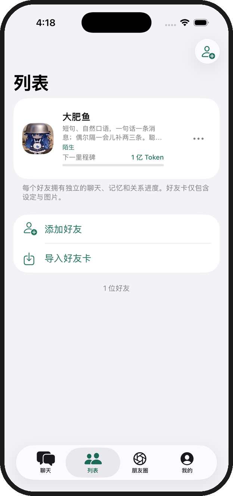
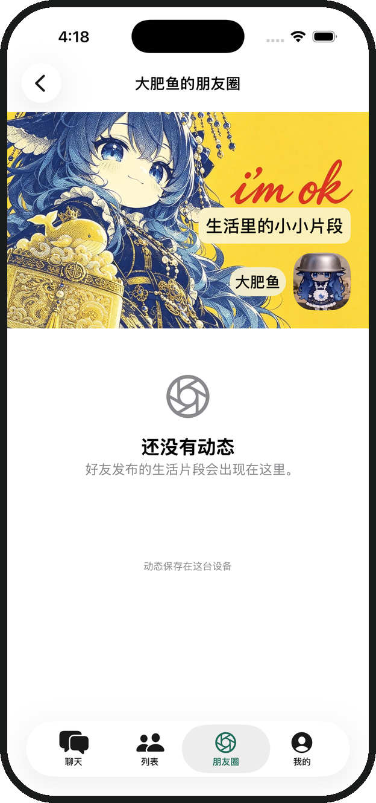
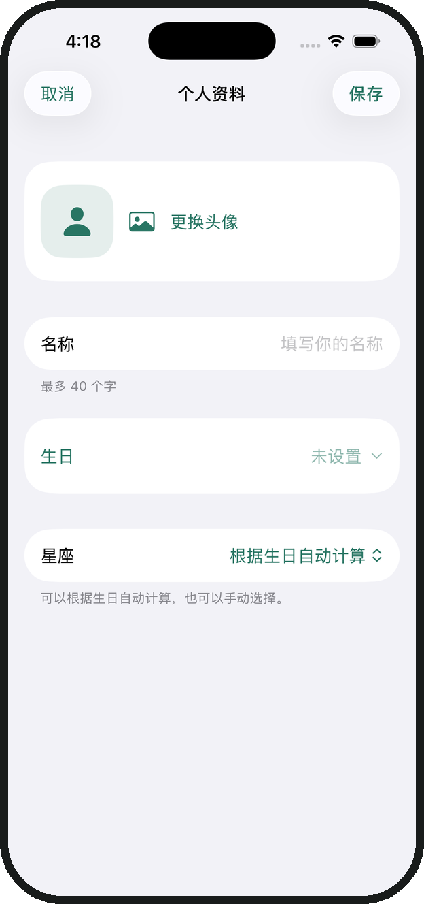

<p align="center">
  
</p>
<h1 align="center">Lumi</h1>
<p align="center"><strong>和 AI 好友聊日常，也把彼此的故事留在这里。</strong></p>
<p align="center">原生 iOS 聊天应用 · 自定义人设 · 本地记忆 · 朋友圈</p>
<p align="center">
  
  
  
</p>
<p align="center">
  <a href="https://github.com/NakanoNino233/Lumi/releases/latest">下载 IPA</a> ·
  <a href="#开始使用">开始使用</a> ·
  <a href="Documentation/Installation.md">安装指南</a> ·
  <a href="#功能一览">功能一览</a>
</p>

---

Lumi 把聊天、好友人设、记忆和生活动态放在一个地方。你可以从内置好友「大肥鱼」开始，也可以创建自己的 AI 好友，让不同的角色拥有各自的聊天、设定和相处记录。

**需要自备模型 API Key。下载的 IPA 未签名，安装前需要自行签名。当前源码采用非商业许可，禁止未经授权的商业使用。**

## 看看 Lumi

<table>
  <tr>
    <th width="33%">你的好友</th>
    <th width="33%">生活里的小片段</th>
    <th width="33%">从认识你开始</th>
  </tr>
  <tr>
    <td align="center"></td>
    <td align="center"></td>
    <td align="center"></td>
  </tr>
</table>

实际 App 界面截图，使用空白演示资料。好友头像、封面和自己的资料都可以按喜好调整。

## 功能一览

| 想做什么 | Lumi 可以帮你 |
| --- | --- |
| 和好友聊日常 | 流式回复、图片附件、语音输入、消息朗读、表情，也支持群聊和聊天记录分享 |
| 创建自己的角色 | 编辑头像、人设、背景故事、说话风格和开场白，导入或导出 JSON 好友卡 |
| 留下相处的记录 | 本地记忆、日记、纪念日、关系进度，以及可选的主动问候 |
| 分享生活片段 | 朋友圈动态、评论与点赞，自定义封面和个性化标签 |
| 让好友了解你 | 首次填写个人资料卡，随时修改头像、名称、生日和星座；朋友圈头像同步更新 |
| 自选模型服务 | DeepSeek、ChatGPT、Claude 和自定义模板，可编辑地址、模型与能力开关 |
| 管理使用体验 | Token 用量统计、主题与深色模式、中英文、小组件、实时活动、备份与恢复 |

图片理解等能力取决于你配置的模型。自动记忆、日记和连接测试也可能调用模型，产生相应的服务商费用。

## 开始使用

### 1. 下载并安装

前往 [Releases](https://github.com/NakanoNino233/Lumi/releases/latest)，下载 `Lumi-unsigned.ipa`。同页提供 SHA-256 校验文件。

最低需要 **iOS 17**。IPA 需要使用自己的签名工具签名后安装，具体步骤见 [安装与续签指南](Documentation/Installation.md)。包中包含 `LumiWidgets` 扩展；需要小组件与实时活动时请保留该扩展。

### 2. 填写你的资料卡

首次进入时设置头像、名称、生日和星座。这些信息之后都可以在「我的」中修改。自己的朋友圈头像会跟随个人资料更新，好友回答你的生日问题时会参考你填写的资料。

### 3. 配置模型

打开 **我的 → 设置 → API 配置**，选择模板，填写服务地址、模型名称和自己的 API Key，测试连接后保存。

| 模板 | 使用前需要准备 |
| --- | --- |
| DeepSeek | 对应服务商的 API Key 和可用模型名称 |
| ChatGPT | OpenAI API Key 和账号可用的模型名称 |
| Claude | Anthropic API Key 和账号可用的模型名称 |
| 自定义 | 自己的兼容服务地址、API Key 和模型名称 |

模板用于帮助填写配置，不包含 API 额度。**请按服务商控制台填写实际可用的模型名称**，并让图片、工具等能力开关与模型一致。服务商的聊天订阅与 API 计费应分别向服务商确认。

### 4. 开始聊天，慢慢完善

在「聊天」中打开大肥鱼，或在「列表」添加自己的好友。编辑人设，试着聊一段日常，再去「朋友圈」设置封面和标签。需要换设备或更新时，先在 App 内导出备份。

## 数据与隐私

聊天、个人资料、记忆和偏好保存在本机，API Key 存在系统钥匙串中。模型请求会将相应内容发送至你配置的服务商；自动记忆与日记也会使用相关历史。天气等可选功能需要另行开启或授权。

备份包含个人资料和聊天内容，**不包含 API Key**。请妥善保管备份，反馈问题或分享截图前隐藏私人信息。

## 常见问题

<details>
<summary>下载后为什么不能直接安装？</summary>

发布的是未签名 IPA，需要签名后才能在 iPhone 上运行。安装和续签方式请参考 [安装指南](Documentation/Installation.md)。

</details>

<details>
<summary>配置完还是没有回复，怎么办？</summary>

先使用 API 配置里的连接测试，检查服务地址、API Key、账号额度和模型名称。模板中的名称可以修改，以服务商账号实际可用模型为准。提交问题时请隐藏 Key 和聊天隐私。

</details>

<details>
<summary>更新或换手机会丢记录吗？</summary>

更新前先导出备份，尽量使用原签名工具更新同一应用。删除 App 会移除本机应用数据；换设备后可导入备份，API Key 需要重新填写。

</details>

<details>
<summary>能用这个项目做商业产品吗？</summary>

当前许可不授权商业用途。个人学习、研究和非商业使用请遵循 [LICENSE](LICENSE)；收费分发、商业产品集成等需要另行授权。旧版本授权与第三方素材说明见 [许可说明](LICENSING.md)。

</details>

## 从源码运行

使用 **Xcode 26 或更高版本**打开 `Lumi.xcodeproj`，选择 `Lumi` scheme 和 iPhone 模拟器运行。项目使用 Swift 6、SwiftUI 和 SwiftData，ZIPFoundation 作为本地依赖随仓库提供。

真机运行时，在主程序和 `LumiWidgets` 的 Signing & Capabilities 中选择自己的开发团队，并按需要修改两个目标的 Bundle Identifier。

<details>
<summary>构建 IPA 与运行测试</summary>

在项目根目录生成未签名安装包：

```bash
bash Distribution/build-unsigned.sh
```

输出位于 `Distribution/output/`。安装包通过 GitHub Release 发布，源码仓库忽略构建缓存、本机测试报告、用户配置与签名文件。

在 Xcode 中使用 Product → Test。自动测试使用本地模拟响应，不需要真实模型 Key。仓库提供「Build Lumi unsigned IPA」工作流，可在 Actions 中手动运行；推送 `v` 开头的标签时会构建并发布对应 Release。首次 `1.0.0` Release 使用本机验证的安装包。

模型回复效果、真机语音与触感、小组件展示及安装续签体验仍需在实际设备和服务商环境中验证。

</details>

## 许可与贡献

**当前 Lumi 自有代码采用 [PolyForm Noncommercial License 1.0.0](LICENSE)，禁止未经授权的商业使用。** 允许的非商业用途及其他条件以许可原文为准。这是源码可用项目，不属于 OSI 定义的开源许可。

历史 `1.0.0` 版本已按 MIT 发布，原有授权继续有效；完整适用范围见 [许可说明](LICENSING.md)。第三方依赖保留各自许可。图标、人物头像、朋友圈图片及截图中的素材不随代码授予图片权利，复用前请取得授权或替换，详见 [第三方与素材声明](THIRD_PARTY_NOTICES.md)。

欢迎通过 [Issues](https://github.com/NakanoNino233/Lumi/issues) 反馈可复现的问题，或提交 Pull Request。反馈时请附上系统版本、复现步骤和已去除私人信息的截图。
